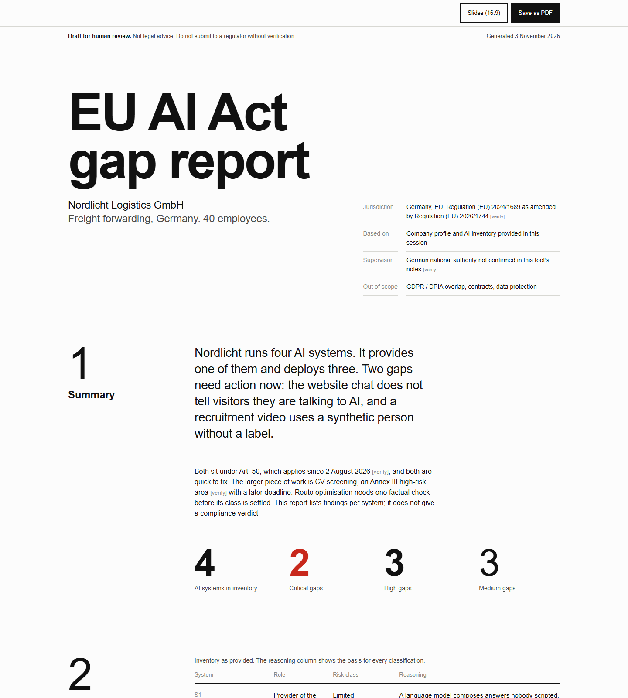

# AI Act Check

**A free first check of where your business stands under the EU AI Act.** You answer a short interview about how your company uses AI. You get back a list of your AI tools, your role for each one, and a gap report: what to fix first, and by when.

**Works in any AI chat (ChatGPT, Gemini, Claude.ai) with nothing to install - or as a Claude Code / Cowork plugin.**

**Last legal review:** 10 October 2026. The dates and statuses in [`references/eu-ai-act-notes.md`](references/eu-ai-act-notes.md) were checked against the Regulation and the Digital Omnibus; a line-by-line read of the consolidated text is still open.

> [!IMPORTANT]
> This tool produces a **draft for human review**. It is not legal advice and not a substitute for a lawyer or compliance specialist. AI Act obligations and deadlines are still changing (see the Digital Omnibus package) - treat every output as a starting point, not a binding position.

[](assets/report-sample.html)

*What you get at the end: a sample gap report for a fictional company. [Open the HTML file](assets/report-sample.html) (download it and open it in a browser). The buttons at the top save it as an A4 PDF or as 16:9 slides.*

---

## Use it in a chat (no install)

No agent? The method is just a prompt - it works in ChatGPT, Gemini, Claude.ai, or any assistant.

**Simplest (if your assistant can browse the web):** paste this one line into ChatGPT, Claude, or Gemini -

> Run my free EU AI Act check, following the instructions at https://raw.githubusercontent.com/30Elevate/ai-act-check/main/USE-ANYWHERE.md - start with the first question, in my language.

Your assistant fetches the prompt and starts the interview.

**Always works (no web access needed):** open [`USE-ANYWHERE.md`](USE-ANYWHERE.md), click the copy button on the prompt block, and paste it as your first message. Same interview -> inventory -> gap report flow, same guardrails.

## Who it is for

Small and medium businesses (SMBs) in the EU that use or deploy AI systems (chatbots, content generators, scoring, decision automation) and want to know:

- whether the transparency obligation (Art. 50) applies to them, and from when,
- what role they play for each AI system (provider / deployer / importer / distributor),
- whether any AI system is high-risk (Annex III) or falls under a prohibited practice (Art. 5),
- whether their staff have the required AI literacy (Art. 4).

## What it does

Three skills that lead from interview to report:

| Skill | Role |
|---|---|
| `cold-start-interview` | Short interview building the company profile (role, AI systems, jurisdiction). Skipping it makes every later output generic. |
| `ai-inventory-eu` | AI system inventory - works out your role and a first-pass risk tier per system, since both can differ from one system to the next, not just company-wide. |
| `gap-report` | Compliance gap report - what is missing, priorities, deadlines. Output as a single HTML file filled from a fixed template: share it by link, or save it as an A4 PDF or 16:9 slides. |

## Install as a plugin or skills

A plugin for [Claude Code](https://claude.com/claude-code) / Claude Cowork, and plain [Agent Skills](https://agentskills.io) for Codex, Gemini CLI and other agents that read SKILL.md.

**Claude Code / Cowork:** add this repo as a plugin marketplace and install it:

```
/plugin marketplace add 30Elevate/ai-act-check
/plugin install ai-act-check@ai-act-check
```

**Restart Claude Code** - the commands are not live until you restart. Then run, in order:

```
/ai-act-check:cold-start-interview
/ai-act-check:ai-inventory-eu
/ai-act-check:gap-report
```

**Codex, Gemini CLI and other agents:** install the three skills with the open-source [skills CLI](https://github.com/vercel-labs/skills). It asks which agent to install them for:

```
npx skills add 30Elevate/ai-act-check
```

Then ask your agent to run the cold-start interview, the AI inventory and the gap report, in that order. Each skill carries its own copy of the guardrails and legal notes, so it works on its own.

Prefer not to install? Clone the repo and point your agent at the `skills/` folder:

```
git clone https://github.com/30Elevate/ai-act-check.git
```

The skills save their working files (profile, inventory, report) to `.ai-act-check/` in your project. It holds your company data - add `.ai-act-check/` to your `.gitignore`.

**Language:** instructions are written in English, but each skill runs the interview and produces output in the user's language (e.g. Polish, English). A Polish SMB gets a Polish conversation.

**Privacy:** the check runs entirely in your own AI session. Your answers stay with you - 30Elevate never sees or stores them.

## Structure

```
ai-act-check/
├── .claude-plugin/
│   ├── marketplace.json         # makes the repo installable as a plugin
│   └── plugin.json              # plugin manifest (name, version, license)
├── .github/workflows/check.yml  # CI: copies in sync + structural checks
├── assets/                      # sample gap report (HTML + screenshot)
├── evals/README.md              # scenarios to run by hand against each skill
├── skills/
│   ├── cold-start-interview/     # SKILL.md + references/ (copies of the two files below)
│   ├── ai-inventory-eu/
│   └── gap-report/               # + assets/report-template.html
├── guardrails/GUARDRAILS.md      # safety rules for outputs (disclaimer, [verify], gate)
├── references/eu-ai-act-notes.md # working legal notes (verify against current text)
├── scripts/sync-skills.mjs       # copies the two files above into each skill
├── scripts/check.mjs             # checks frontmatter, paths, guardrail refs, dates, template
├── USE-ANYWHERE.md               # the same method as one portable prompt (ChatGPT, Gemini, ...)
└── AGENTS.md                     # guidance for AI agents working in this repo
```

## Guardrails

Every output goes through the rules in [`guardrails/GUARDRAILS.md`](guardrails/GUARDRAILS.md): disclaimer, marking uncertain claims with `[verify]`, surfacing jurisdiction assumptions, no silent classification, no fabricated legal citations or links, no compliance verdicts, no fear-selling and no sales pitch in the chat, a gate before anything is sent to a regulator.

## Full audit

This is the free, self-service version. The full AI Act Check (a scan of your real systems, human review and recommendations) is our service: **[AI Trust Layer at 30elevate.com](https://30elevate.com/en/services/ai-trust-layer/)**.

## License

[MIT](LICENSE). Copyright (c) 2026 30Elevate.

## About

[30Elevate](https://30elevate.com) - AI agency for business. Websites, AI agents, training, and AI compliance.
